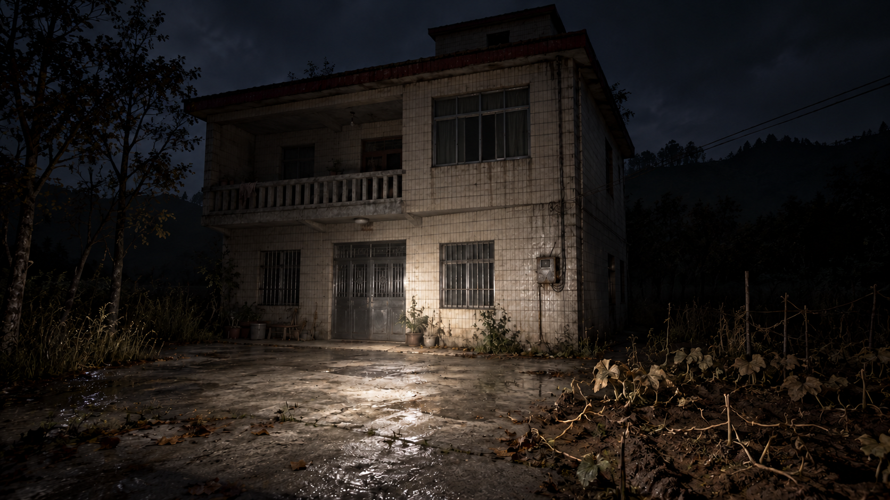
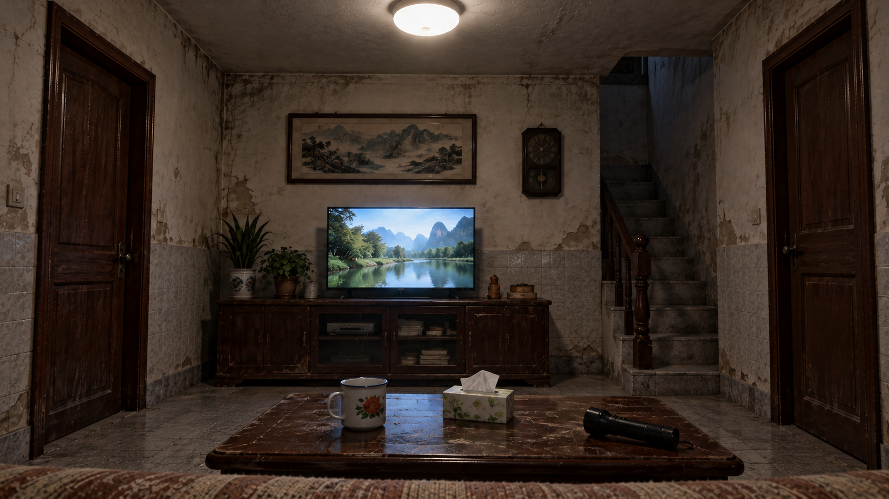
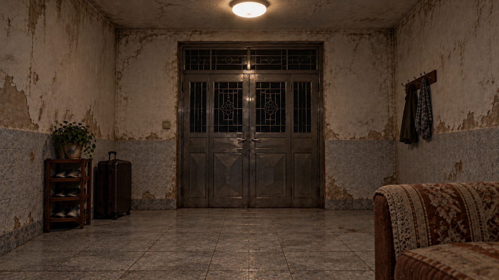
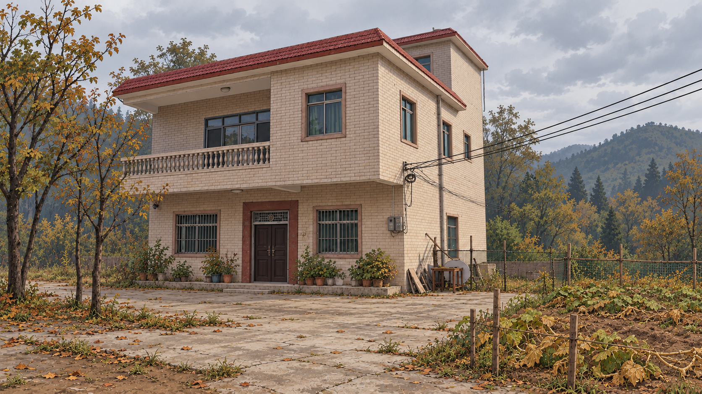
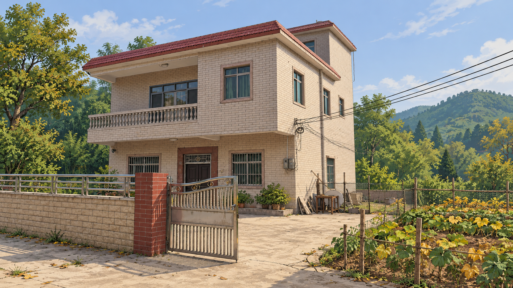
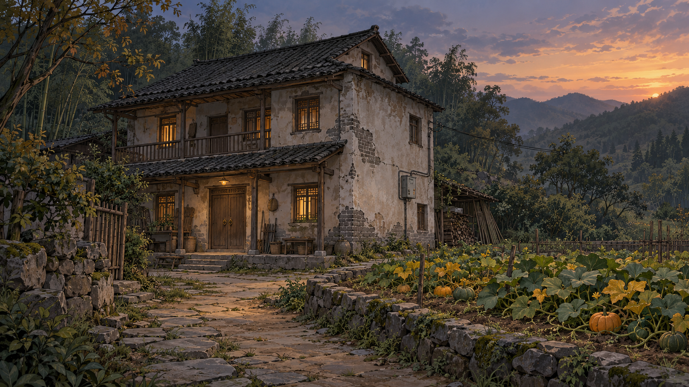
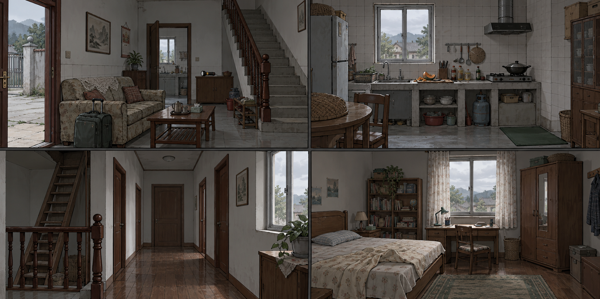

# 归宅 · 图片画廊

## 当前方向：写实恐怖夜景

保留两层贴砖自建房、小阁楼、右墙电闸和无果实的枯藤土垄，以夜色、真实旧化材质和局部手电照明表现危险。

[查看或下载原图](game/assets/house-exterior-v5.png)

## 客厅：沙发上的视角

## 大门口：转身后的视角

## 第三版：萧条秋日

## 第二版：农村自建房

## 第一版：黄昏旧宅

## 室内四场景：早期概念

客厅、厨房、二楼走廊和女主卧房。尚未按新写实风格重绘。

## 发布网页画廊

网页文件为 `game/gallery.html`，与试玩使用同一站点。本站暂未在本次操作中完成 Netlify 账号绑定或验证线上部署。

[使用此 GitHub 仓库创建 Netlify 站点](https://app.netlify.com/start/deploy?repository=https%3A%2F%2Fgithub.com%2Fkunkun2222%2Fcodex)

登录 Netlify 并授权 GitHub 后按提示创建站点。分支 `main`，Base directory 留空，Build command 留空，Publish directory 为 `game`。仓库根目录 `netlify.toml` 已设置发布目录。创建后网站首页可进入图片画廊，或在站点网址后加 `/gallery.html`。

已有 Netlify 项目时，请在项目设置中连接此仓库，不必再次创建。仓库文件只能准备部署，不能替代 Netlify 账号授权。
